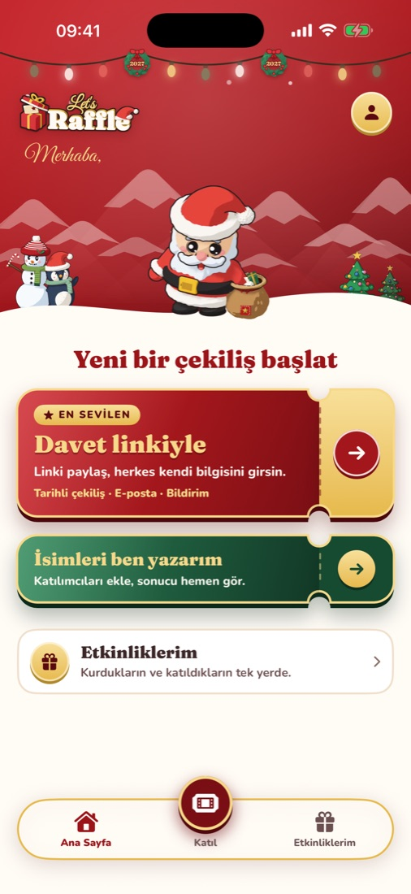
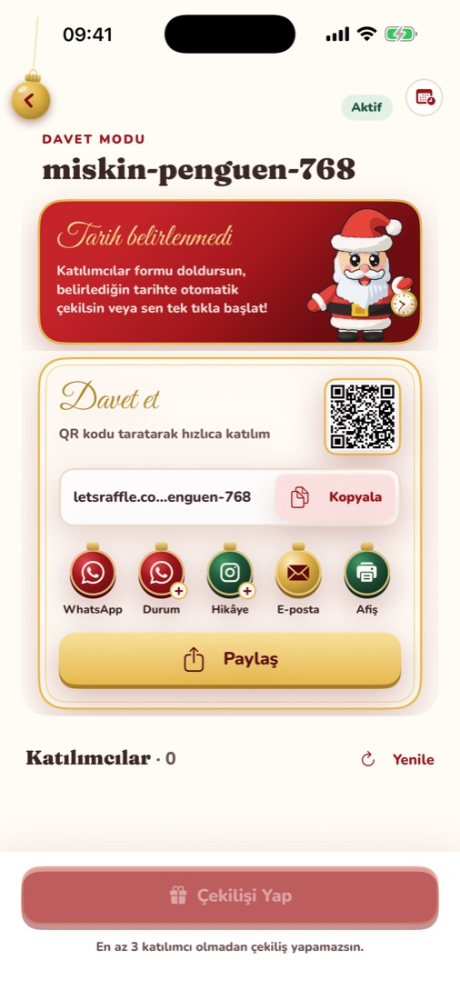
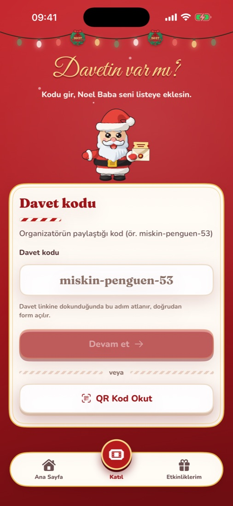
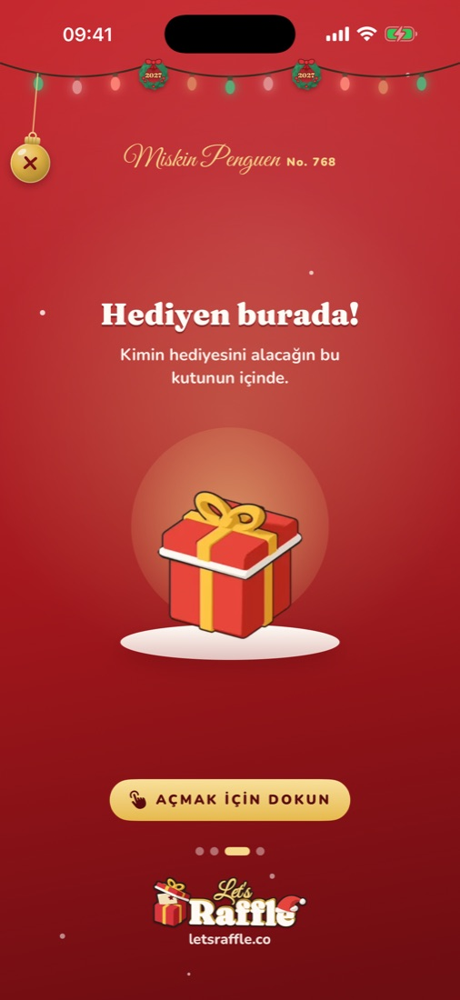
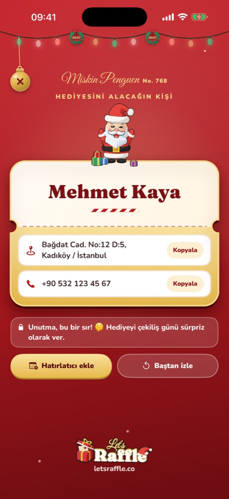
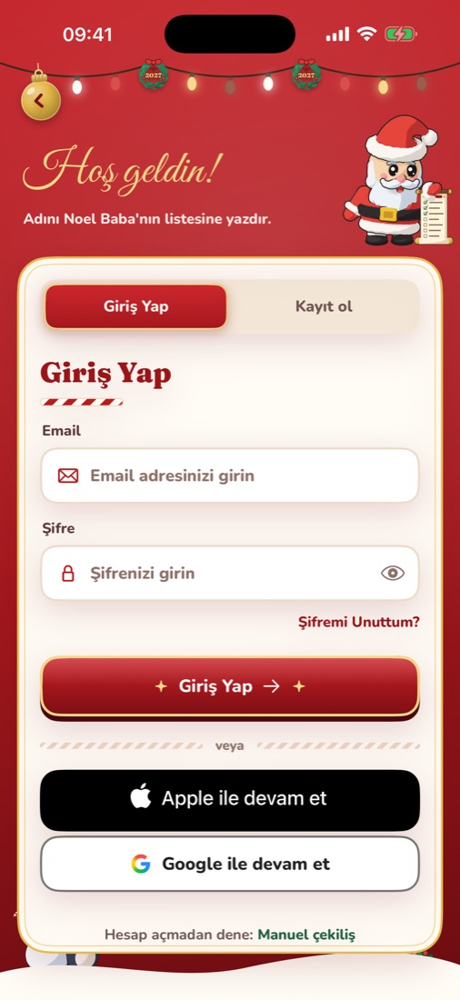
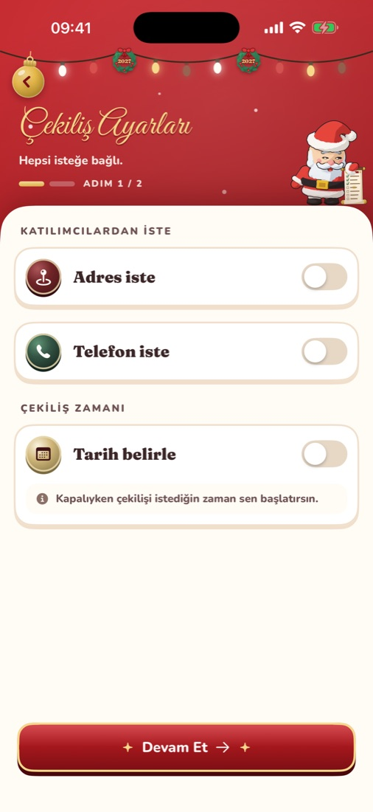
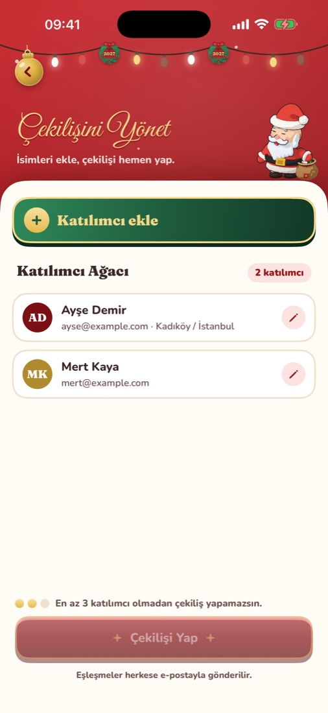
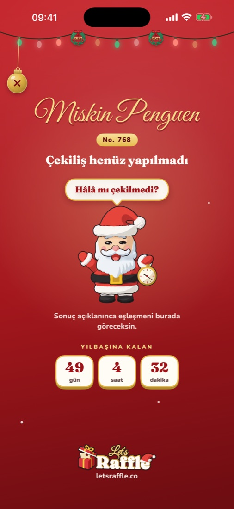

<p align="center">
  
</p>

<h1 align="center">Lets Raffle for iOS</h1>

<p align="center">
  Secret Santa without the paper slips: create a gift exchange, share the link, and let Santa tell everyone who they are buying for.
</p>

<p align="center">
  <a href="https://letsraffle.co">letsraffle.co</a>
</p>

<p align="center">
  
  
  
  
  
</p>

## Features

- **Two ways to draw.** Invite mode: share a link or QR code and everyone fills in their own details. Manual mode: type the names yourself and draw right away, no account needed.
- **Scheduled or on demand.** Let the draw run automatically at a date you pick, or start it with one tap.
- **Invitations that travel.** Share to WhatsApp or e-mail, export a 9:16 story card, or print an A4 poster with a QR code for the office wall.
- **A proper reveal.** Each participant only sees their own match, unwrapped step by step.
- **Everything in one place.** The draws you created and the ones you joined live in the Events tab, with a New Year countdown while you wait.
- **Turkish and English**, a home screen widget, and push notifications.

## Screenshots

| Sign in | Draw settings | Manual draw | Waiting | Reveal |
|---|---|---|---|---|
|  |  |  |  |  |

## Tech

SwiftUI, Swift Concurrency, WidgetKit. The only third-party dependency is Google Sign-In. The project file is generated with [XcodeGen](https://github.com/yonaskolb/XcodeGen). The backend is [letsraffle-api](https://github.com/selamet/letsraffle-api) (FastAPI) and the web client is [letsraffle-web](https://github.com/hakanbudak/letsraffle-web) (Vue 3).

## Requirements

- Xcode 16+ (iOS 17 SDK or newer)
- XcodeGen: `brew install xcodegen`

## Getting started

```bash
make generate   # creates LetsRaffle.xcodeproj from project.yml
make open       # opens the project in Xcode
make test       # runs unit tests on the simulator
```

The Xcode project is generated and not committed; edit `project.yml` instead.

## Configuration

| Key            | Debug                          | Release                             |
|----------------|--------------------------------|-------------------------------------|
| `API_BASE_URL` | `http://localhost:8000/api/v1` | `https://api.letsraffle.co/api/v1`  |
| `WEB_BASE_URL` | `https://letsraffle.co`        | `https://letsraffle.co`             |

Override locally by creating `Config/Secrets.xcconfig` (git-ignored), e.g.

```
API_BASE_URL = http:$(SLASH)/192.168.1.20:8000/api/v1
```

## Structure

```
LetsRaffle/
├── App/            # entry point, settings, config
├── DesignSystem/   # palette, components, illustrations
├── Features/       # auth, draws, invite and manual draw, join, reveal, events, profile
├── Localization/   # TR / EN strings
├── Models/         # API models
├── Networking/     # API client
├── Session/        # sign-in state
└── Resources/      # assets, fonts, figures
LetsRaffleWidgets/  # home screen widget
LetsRaffleTests/    # unit tests
```
